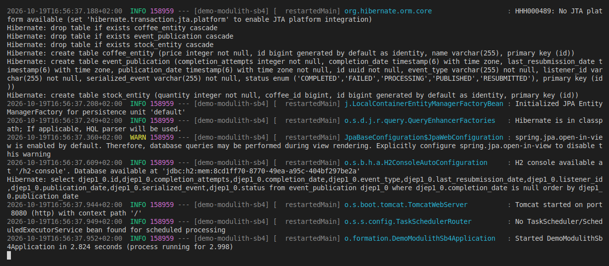
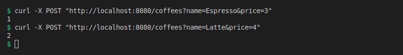
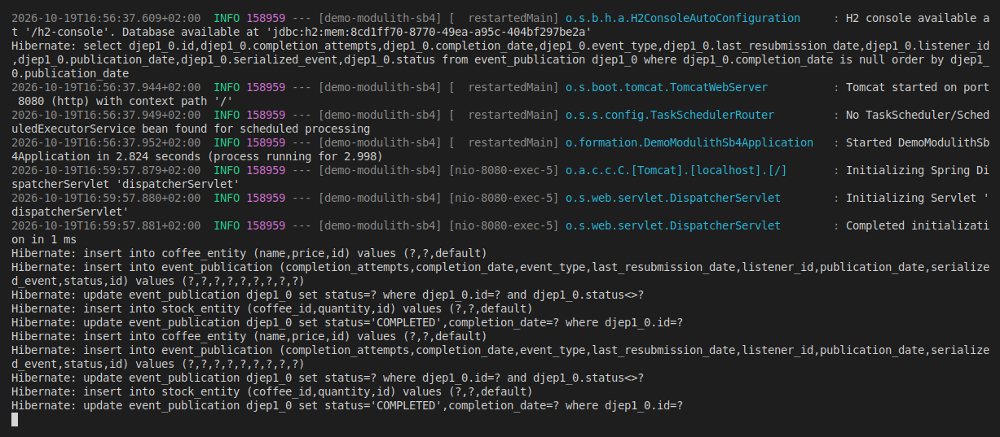
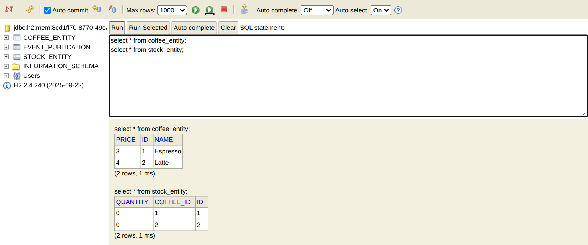
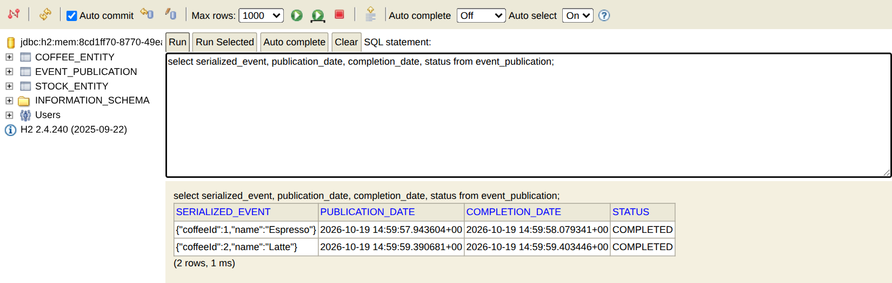
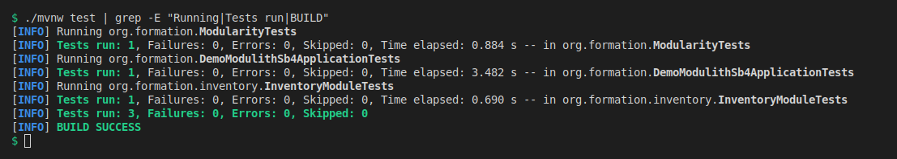
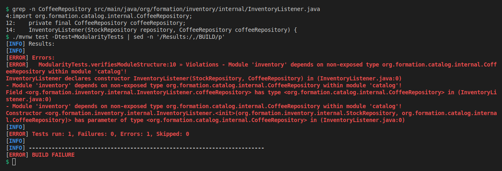

# demo-modulith-sb4

Small Spring Modulith project with two modules, `catalog` and `inventory`, that talk to each other through an event instead of calling each other directly.

When you create a coffee with `POST /coffees`, `catalog` saves it and publishes a `CoffeeCreated` event. `inventory` listens to that event and creates the stock row for the coffee (quantity 0). `catalog` never calls `inventory`.

Stack: Java 25, Spring Boot 4.0.8, Spring Modulith 2.0.8, Spring Data JPA, H2 (in memory), Maven.

## Run it

```
./mvnw spring-boot:run
curl -X POST "http://localhost:8080/coffees?name=Espresso&price=3"
./mvnw test
```

H2 console: http://localhost:8080/h2-console (JDBC URL is printed in the startup logs, user `sa`, empty password).

## Screenshots

**Startup.** Hibernate creates the three tables: `coffee_entity`, `stock_entity` and `event_publication`. The last one is created by Modulith to keep track of published events.



**Creating two coffees.** Each call returns the id of the new coffee.



**SQL in the logs.** For each coffee: insert the coffee, register the event, mark it as processing, insert the stock row (done by `inventory`), mark the event as completed.



**H2 console: coffees and stock.** Two coffees, and two stock rows that nobody created by hand.



**H2 console: event registry.** Both events are stored and marked `COMPLETED`.



**Tests.** All 3 tests pass.



**Module boundary check.** I temporarily made `InventoryListener` use `catalog.internal.CoffeeRepository` (a class `catalog` keeps private). It still compiles, but `ModularityTests` fails. Removing it makes the test pass again.



## Tests

- `ModularityTests`: checks that no module uses another module's `internal` package.
- `InventoryModuleTests`: starts only the `inventory` module, publishes a `CoffeeCreated` event and waits for the stock row.
- `DemoModulithSb4ApplicationTests`: the whole app starts.

The screenshots come from the real app and real commands, run from a clean copy of this repo. The violation screenshot was taken on a temporary copy with the forbidden access added.
